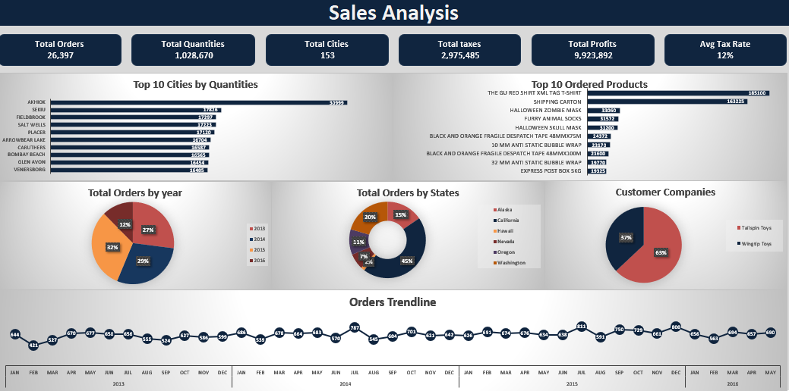

# Company Sales Analysis | Excel

## Project Overview

This project focuses on analyzing company sales performance and monitoring key business metrics through an Excel dashboard.

The analysis was developed using Microsoft Excel, Power Query, and Power Pivot, with a Data Model to organize and analyze the sales data.

## Tools & Technologies

- Microsoft Excel
- Power Query – Data preparation and transformation
- Power Pivot – Data modeling and analysis
- Data Model

## Project Structure

The workbook contains the following main components:

- **Raw Data:** Original sales data.
- **DimDate:** Date dimension table.
- **DimStockItem:** Stock item dimension table.
- **FactSale:** Sales fact table.
- **Analysis:** Supporting analysis.
- **Dashboard:** Sales performance visualizations and KPIs.

## Key Performance Indicators (KPIs)

The dashboard presents the following metrics:

| KPI | Value |
|---|---:|
| Total Orders | 26,397 |
| Total Quantities | 1,028,670 |
| Total Cities | 153 |
| Total Taxes | 2,975,485 |
| Total Profits | 9,923,892 |
| Average Tax Rate | 12% |

*Values are presented as displayed in the original dashboard.*

## Analysis & Visualizations

The dashboard covers several aspects of sales performance:

- **Top 10 Cities by Quantities:** Identifies the cities with the highest order quantities.
- **Top 10 Ordered Products:** Highlights the most frequently ordered products.
- **Total Orders by Year:** Shows the distribution of orders across years.
- **Total Orders by States:** Displays order distribution across states.
- **Customer Companies:** Compares the contribution of customer companies.
- **Orders Trendline:** Tracks monthly order trends from 2013 to 2016.

## Dashboard Preview

## Project Objective

The main objective is to provide an overview of sales performance, monitor key metrics, and explore sales patterns across products, cities, states, customers, and time.

---

**Project Type:** Data Analysis & Dashboard Development  
**Domain:** Sales Analytics  
**Tools:** Excel | Power Query | Power Pivot | Data Modeling
